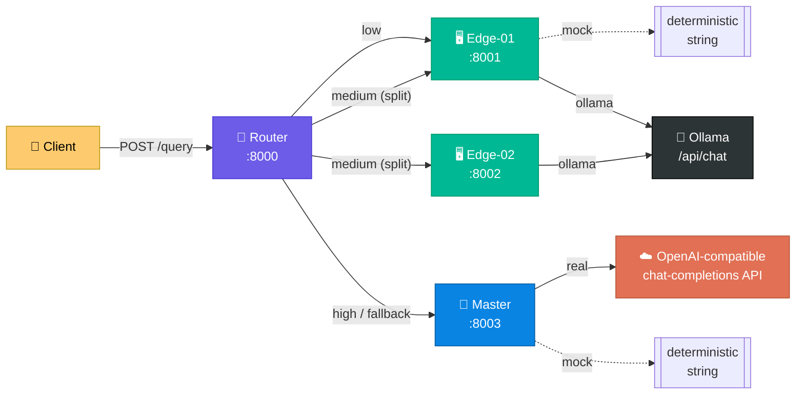
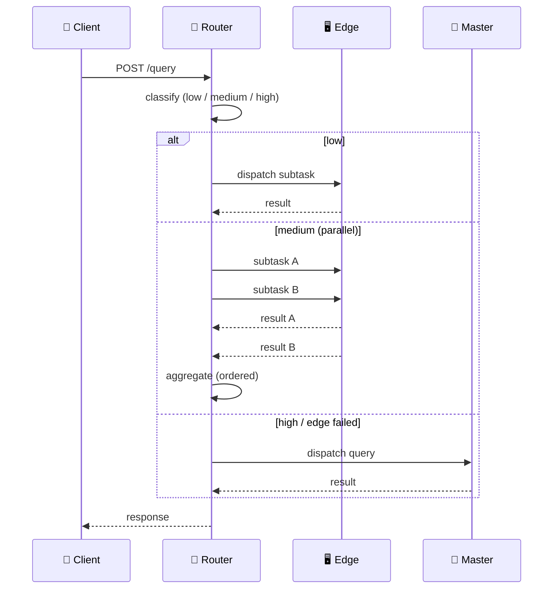
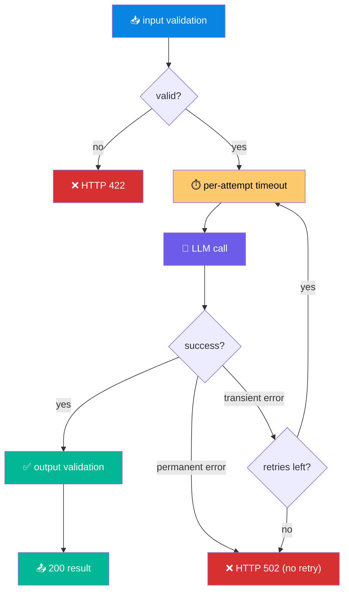
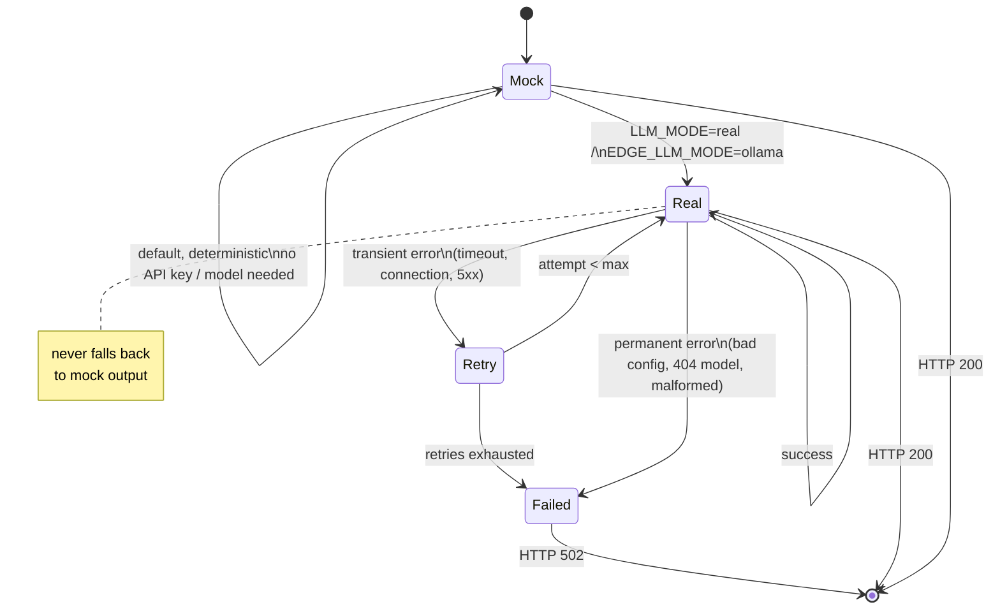

<div align="center">

# 🧠 NOVIX Prototype Backend

[](https://git.io/typing-svg)

**Distributed query routing across local edge LLMs and a master OpenAI-compatible LLM.**


</div>

Implementation algorithms and techniques for each project iteration are tracked in [NOVIX_ITERATION_LOG.md](NOVIX_ITERATION_LOG.md).

## 📑 Contents

- [🧩 Services](#-services)
- [🏗️ Architecture](#️-architecture)
- [🔀 Routing logic](#-routing-logic)
- [⚙️ Execution flow](#️-execution-flow)
- [🔄 Developer workflow](#-developer-workflow)
- [🎛️ LLM mode state machine](#️-llm-mode-state-machine)
- [🚀 Setup](#-setup)
- [▶️ Run](#️-run)
- [✅ Tests](#-tests)
- [🐳 Run with Docker Compose](#-run-with-docker-compose)
- [📡 Example requests](#-example-requests)
- [📋 Validation status](#-validation-status)

## 🧩 Services

| Service | Endpoints | Role |
| --- | --- | --- |
| 🔀 **Router** | `POST /query` | Classifies queries and routes them using live node resources. |
| 🖥️ **Edge** | `GET /health`, `GET /resources`, `POST /execute` | Reports host CPU/memory via `psutil`. Executes through `EDGE_LLM_MODE`: `mock` (default, deterministic, no model needed) or `ollama` (calls a configured Ollama endpoint). |
| 🧠 **Master** | `GET /health`, `GET /resources`, `POST /execute` | Validates and executes queries through the final AI layer. |

## 🏗️ Architecture



## 🔀 Routing logic

The router uses deterministic keyword and query-length rules (no extra routing model) to classify requests as `low`, `medium`, or `high`:

| Class | Behavior |
| --- | --- |
| 🟢 **Low** | Executes on the least-loaded edge. |
| 🟡 **Medium** (parallelizable) | Splits into two deterministic subtasks, sent concurrently to two available edges; returns real LLM outputs plus an ordered aggregate. |
| 🔴 **High** (or indivisible) | Executes on master. |

Resource probes include CPU, RAM, and LLM availability. If an edge execution fails, the router retries the query on master when available.



## ⚙️ Execution flow

**Master** — input validation → up to two retries → per-attempt timeout → LLM call → output validation.

- `LLM_MODE=mock` — deterministic, no API key required.
- `LLM_MODE=real` — calls the configured OpenAI-compatible chat-completions endpoint.

**Edge** — the same shape: input validation → up to two retries → per-attempt timeout → LLM call → output validation.

- `EDGE_LLM_MODE=mock` (default) — deterministic, no HTTP call, returns a fixed `f"Mock edge response for: {query}"` string.
- `EDGE_LLM_MODE=ollama` — calls `OLLAMA_URL`'s `/api/chat` endpoint. Permanent failures (bad config, missing model, malformed response) are not retried; connection errors, timeouts, and 5xx responses are retried up to twice.



Each edge independently selects mock or Ollama execution, so subtasks sent to different edges may be answered by different, independently running models — this is not single-model distributed inference. Real mode never falls back to mock output.

## 🔄 Developer workflow

```mermaid
flowchart LR
    A["✏️ Code change"] --> B["🧪 python -m pytest"]
    B --> C{"pass?"}
    C -- no --> A
    C -- yes --> D["🐍 py_compile sanity"]
    D --> E["🐳 docker compose up --build"]
    E --> F["🔎 curl /health + /resources"]
    F --> G["📨 POST /query smoke test"]
    G --> H["📝 update NOVIX_ITERATION_LOG.md"]
    H --> I["✅ commit"]

    style A fill:#FDCB6E,color:#000
    style B fill:#0984E3,color:#fff
    style D fill:#0984E3,color:#fff
    style E fill:#2496ED,color:#fff
    style F fill:#6C5CE7,color:#fff
    style G fill:#6C5CE7,color:#fff
    style H fill:#00B894,color:#fff
    style I fill:#00B894,color:#fff
```



## 🎛️ LLM mode state machine

Each service (master, edge) resolves its execution mode independently from its own env var (`LLM_MODE` for master, `EDGE_LLM_MODE` for edge):



## 🚀 Setup

```bash
python3 -m venv .venv
source .venv/bin/activate
pip install -r requirements.txt
```

Copy `.env.example` to `.env` for local configuration. The default mock mode works without credentials:

```bash
cp .env.example .env
```

## ▶️ Run

Run each service in a separate terminal from the project root:

```bash
uvicorn app.router_service:app --reload --port 8000
uvicorn app.edge_service:app --reload --port 8001
uvicorn app.edge_service:app --reload --port 8002
uvicorn app.master_service:app --reload --port 8003
```

Interactive API documentation is available at `/docs` for each service.

The presentation dashboard is served by the router at [http://localhost:8000/dashboard/](http://localhost:8000/dashboard/). It polls edge/master resources and sends queries to the router API.

## ✅ Tests

```bash
python -m pytest
```

Tests mock all outbound HTTP calls (via `respx`), so they do not require a live model or network access.

## 🐳 Run with Docker Compose

Docker Compose starts the router, two edge nodes, and the master on the shared `novix-network` network:

```bash
docker compose up --build
```

Compose reads `.env` automatically. Mock mode runs fully offline.

### ☁️ Real mode (master)

For master to call a real OpenAI-compatible endpoint:

```bash
cp .env.example .env
# Set LLM_MODE=real and LLM_API_KEY in .env.
docker compose up --build
```

### 🦙 Ollama mode (edges)

The `ollama` service is opt-in via a Compose profile, so the default `docker compose up --build` flow is unchanged and keeps working offline.

```bash
docker compose --profile ollama up -d ollama
docker compose exec ollama ollama pull llama3.2
```

> ⚠️ The model is **not** downloaded automatically — the `ollama pull` step above is required before the edges can serve real responses.

Then set in `.env`:

```bash
EDGE_LLM_MODE=ollama
OLLAMA_MODEL=llama3.2
```

and restart the edge containers:

```bash
docker compose up -d edge-01 edge-02
```

### 🔌 Container addresses

| From | Router | Edge nodes | Master |
| --- | --- | --- | --- |
| Container-to-container | `http://router:8000` | `http://edge-01:8000`, `http://edge-02:8000` | `http://master:8000` |
| From host | `:8000` | `:8001`, `:8002` | `:8003` |

## 📡 Example requests

```bash
curl http://localhost:8001/health
curl http://localhost:8001/resources

curl -X POST http://localhost:8000/query \
  -H 'Content-Type: application/json' \
  -d '{"query":"summarize this short text"}'

curl -X POST http://localhost:8001/execute \
  -H 'Content-Type: application/json' \
  -d '{"task":"summarize","payload":{"text":"hello"}}'

curl -X POST http://localhost:8003/execute \
  -H 'Content-Type: application/json' \
  -d '{"task":"answer","payload":{"query":"Explain the NOVIX routing flow."}}'
```

🚫 No Kubernetes, Redis, Kafka, Celery, or cloud deployment configuration is included.

## 📋 Validation status

Python compilation and Compose configuration pass locally. Runtime mock execution, routing, fallback, LLM failure, Docker startup, Ollama inference, and OpenAI-compatible inference remain unverified without dependencies, Docker, runtimes, or credentials.
